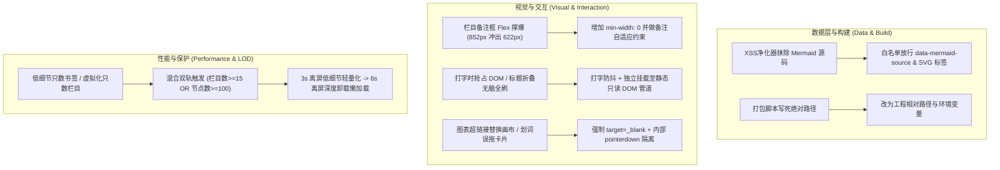
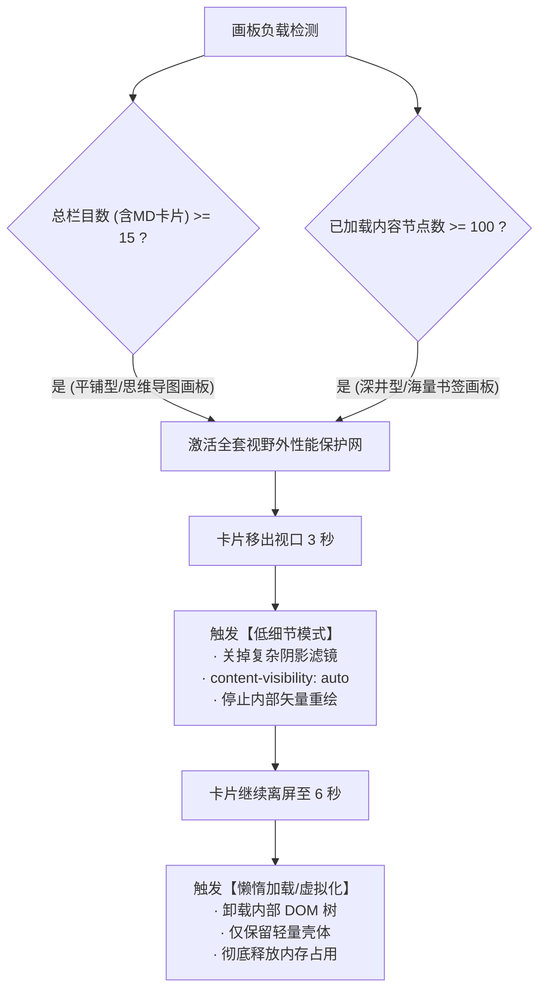

# Bookmark Canvas: Mermaid 渲染与性能架构综合治理实施计划书

> [!NOTE]
> 本计划书整合了针对 commit `adef06f`（基于 Pele.js 的 Mermaid 渲染移植）的代码审计、CodeGraph 符号追踪、26 张卡片真机压力测试，以及最新关于**「低细节模式与虚拟化协同架构」**的讨论共识，旨在为项目提供一份严谨、清晰、可落地的工程实施方案。

---

## 一、背景与治理目标

在本次移植中，系统引入了轻量级离线 Mermaid 渲染器（Pele.js），显著降低了传统 Mermaid 运行时的包体与解析负担。但在实际多卡片（空白栏目、临时栏目、永久栏目）及编辑交互场景中，暴露出若干影响**数据安全**、**视觉版面**与**性能协同**的缺陷。

### 核心治理目标
1. **零数据丢失（P0）**：彻底解决卡片编辑保存时图表源码被净化器物理抹除的严重 Bug；
2. **规范视觉版面（P0）**：根治栏目卡片备注框内图表横向暴冲溢出卡片、鼠标悬浮穿透错位的视觉顽疾；
3. **工程通用化（P0）**：消除打包脚本中写死的开发者本地路径，保证跨设备与 CI/CD 构建能力；
4. **编辑与渲染解耦（P1）**：实施打字防抖，阻断实时编辑与 DOM 渲染的冲突，消除旧折叠函数的无谓性能消耗；
5. **性能架构大统揽（P1）**：将「视野外低细节模式（LOD）」与「视野外懒惰加载（虚拟化）」统一为双轨混合触发体系，彻底覆盖纯 Markdown 与图文思维画板场景；
6. **交互防误触（P1）**：杜绝图表内超链接跳出当前 SPA 画布，隔离图表操作与画布卡片拖拽；
7. **图表文字与徽章显色治理（P0）**：彻底修复时间线（Timeline）、代码版本图（GitGraph）以及时序图（Sequence）中高亮色块“吃掉/遮挡”文字的重大渲染隐患。

---

## 二、核心问题诊断与最终技术方案



---

### 1. 栏目备注框图表横向溢出治理（视觉修复）

#### 根因复盘
在 [bookmark_canvas.css](file:///Users/kk/Downloads/kk/canvas/Bookmark-Canvas/Bookmark-Canvas-main/history_html/bookmark_canvas.css) 中，`.permanent-section-tip-content` 与 `.temp-node-description-content` 配置了 `display: flex; flex: 1 1 0%`，但未显式设置 `min-width: 0`。受 CSS Flexbox 规范影响，子项的最小宽度退化为内容最小宽度（`min-content`）。遇到 Pele 生成的大图（如宽 800px）时，容器强行被拉大到 852px，横向突出卡片边界达 230px，造成悬浮误触与滚动条严重冲突。

#### 落地修复方案
* 在 [bookmark_canvas.css](file:///Users/kk/Downloads/kk/canvas/Bookmark-Canvas/Bookmark-Canvas-main/history_html/bookmark_canvas.css) 中对说明框各层级增加 `min-width: 0 !important`：
  * `.permanent-section-tip-content`、`.temp-node-description-content`；
  * `.permanent-section-tip`、`.temp-node-description`；
* 在 [canvas_obsidian_style.css](file:///Users/kk/Downloads/kk/canvas/Bookmark-Canvas/Bookmark-Canvas-main/history_html/canvas_obsidian_style.css) 中补充特化样式，使图表在 3 行高度的说明框内等比例自适应缩放并支持平滑滚动，无需破坏性弹出浮窗即可在卡片内整洁展示：
  ```css
  .permanent-section-tip .pele-diagram-container,
  .temp-node-description .pele-diagram-container {
      max-height: 160px;
      margin: 4px 0;
      padding: 4px;
      overflow-x: auto;
      overflow-y: auto;
  }
  .permanent-section-tip .pele-diagram-container svg.pele,
  .temp-node-description .pele-diagram-container svg.pele {
      max-width: 100%;
      height: auto;
  }
  ```

---

### 2. XSS 净化器与 Markdown 源码防丢失（数据安全修复）

#### 根因复盘
在 [bookmark_canvas_module.js#L17461-L17536](file:///Users/kk/Downloads/kk/canvas/Bookmark-Canvas/Bookmark-Canvas-main/history_html/bookmark_canvas_module.js#L17461-L17536) 的 `__sanitizeCanvasRichTextHtml` 中，安全白名单未收录 `data-mermaid-source` 属性以及 SVG 矢量标签。卡片重新编辑触发保存时，`__resolveMarkdownSourceFromEditorHtml` 先执行该净化器，导致关键属性与 SVG 标签被全部剥离，仅剩下无语法意义的纯文本碎片，原始 Markdown 代码在数据库中永久丢失。

#### 落地修复方案
* 在 `__sanitizeCanvasRichTextHtml` 的属性白名单中补充：
  * `data-mermaid-source`、`viewBox`、`preserveAspectRatio`、`transform`、`width`、`height`、`fill`、`stroke` 等；
* 在标签白名单中补充：
  * `svg`、`g`、`path`、`rect`、`circle`、`line`、`polygon`、`text`、`tspan`；
* 验证保存链路，确保图表源码与富文本 HTML 始终具备无损的双向还原能力。

---

### 3. 构建脚本通用化路径治理（工程规范修复）

#### 根因复盘
在 [tools/build-pele/build.js#L8](file:///Users/kk/Downloads/kk/canvas/Bookmark-Canvas/Bookmark-Canvas-main/tools/build-pele/build.js#L8) 中，源代码入口被硬编码为特定本地路径：
```javascript
const peleSrcPath = '/Users/kk/Downloads/pele-main/src/index.ts';
```
在任何异机、CI 或项目目录迁移环境中，打包过程将直接报找不到文件而失败。

#### 落地修复方案
* 改为优先从环境变量读取，回退使用项目级相对路径：
  ```javascript
  const peleSrcPath = process.env.PELE_SRC || path.resolve(__dirname, '../../node_modules/@obsidianmd/pele/src/index.ts');
  ```
* 增加源文件存在性校验，提供友好的构建错误提示。

---

### 4. 编辑态打字防抖与生命周期保护（交互与稳定性）

#### 落地修复方案
* **打字防抖（Debounce）**：在用户敲击键盘或处于输入法组字（IME Composition）状态时，绝不调用 Pele 触发任何 DOM 结构刷新；
* **编辑态锁定保护**：在 `renderCanvasMermaidDiagrams` 入口处严格检查目标容器：
  ```javascript
  if (containerEl.contentEditable === 'true' || containerEl.__tiptapInstance) {
      return; // 严禁在活动中的 ProseMirror/TipTap 编辑器内直接操作 DOM
  }
  ```
* **退出时再渲染**：仅在用户失焦（Blur）、点击空白处、或主动提交修改退出编辑态后，在只读视图中执行一次性干净渲染。

---

### 5. 渲染管道解耦（消除历史折叠函数包袱）

#### 落地修复方案
* **脱离历史函数**：将 `renderCanvasMermaidDiagrams` 从历史函数 `__applyHeadingCollapse` [L19048](file:///Users/kk/Downloads/kk/canvas/Bookmark-Canvas/Bookmark-Canvas-main/history_html/bookmark_canvas_module.js#L19048) 中彻底抽离；
* **挂载到只读 DOM 管道**：在 `__buildTiptapObservationDom`（静态只读 DOM 构建器）生成 HTML 或插入卡片后，提供规范的后处理钩子：
  ```javascript
  function __postProcessCanvasObservationDom(containerEl) {
      if (!containerEl) return;
      try { renderCanvasMermaidDiagrams(containerEl); } catch (_) { }
  }
  ```
* 避免用户在折叠卡片内标题时触发全画布的无脑扫描和冗余错误。

---

### 6. 「低细节模式」与「栏目虚拟化」混合双轨触发（性能统一架构）

#### 讨论共识复盘
* **现状**：
  * 「栏目虚拟化」按 `总栏目数 >= 15` 触发（已包含空白卡片 `mdNodes`）；
  * 「低细节模式」按 `已加载节点数（书签+文件夹）>= 100` 触发，漏掉了纯 Markdown 卡片。
* **统一共识（混合双轨触发）**：
  两套机制本质上是**同一条“视野外优化流水线”的时间阶梯**（3秒轻量化 -> 6秒深度卸载），其触发条件应当统一协同，采用**双轨“或（OR）”逻辑**：



#### 落地修复方案
* 修改 [bookmark_canvas_module.js#L35329-L35343](file:///Users/kk/Downloads/kk/canvas/Bookmark-Canvas/Bookmark-Canvas-main/history_html/bookmark_canvas_module.js#L35329-L35343) 的 `__isViewportLowDetailEffective`：
  ```javascript
  function __isViewportLowDetailEffective() {
      if (CanvasState.lowDetailEnabled === false) return false;
      const mode = CanvasState.viewportLowDetailEnabled;
      if (mode === 'off') return false;
      if (mode === 'on') return true;

      // 双轨混合触发：满足任意高负载特征即开启视野外防护
      const totals = __getCanvasTotalDataStatsSync();
      const minNodes = CanvasState.viewportLowDetailMinLoadedNodes || 100;
      const minCols = CanvasState.virtualizationMinColumns || 15;

      const nodesHeavy = ((totals.totalBookmarkCount || 0) + (totals.totalFolderCount || 0)) >= minNodes;
      const columnsHeavy = (totals.totalColumnCount || 0) >= minCols;

      return nodesHeavy || columnsHeavy;
  }
  ```
* 彻底打通纯 Markdown 卡片、图表卡片与传统书签栏目的协同保护壁垒。

---

### 7. 交互防误触与安全加固

#### 落地修复方案
* **超链接安全拦截**：对 Pele 生成的 `<a href>` 自动补齐属性：
  ```html
  <a href="..." target="_blank" rel="noopener noreferrer">
  ```
  防止用户误点图表内超链接直接把当前扩展画布 SPA 页面顶掉；
* **事件防穿透隔离**：在 `.pele-diagram-container` 内部对 `pointerdown` 事件调用 `stopPropagation()`（当目标不是缩放/全屏操作按钮时），防止在图表内选字复制、横向滑动图表时，误触发外层卡片的整体位移。

---

### 8. 时间线（Timeline）与代码版本图（GitGraph）色块遮挡文字治理（样式主题映射修复）

#### 根因复盘
在 [canvas_obsidian_style.css#L4968-L4979](file:///Users/kk/Downloads/kk/canvas/Bookmark-Canvas/Bookmark-Canvas-main/history_html/canvas_obsidian_style.css#L4968-L4979) 中，移植者配置了：
```css
.pele-diagram-container {
    --pele-bg: transparent;
    ...
```
* **致病机理**：移植者原意是想让图表外层容器的背景变透明（不遮挡卡片底色），却误将 `--pele-bg` 设为了 `transparent`。
* **Pele 内部规范**：Pele 的 SVG 规则会将 `--_bg: var(--pele-bg, #fff)` 映射为**高反差对比色（用于有色实底形状上的反白文字）**：
  * **时间线（Timeline）**：年份标题框（`2025 Q1`、`2025 Q3`）的纯色药丸胶囊底色为蓝/橙/绿色，内部文字属性为 `<text fill="var(--_bg)">`；
  * **代码版本图（GitGraph）**：分支标识（`main`、`develop`）的底色为彩色实心框，内部文字属性同样为 `<text fill="var(--_bg)">`；
  * **时序图（Sequence）**：步骤序列号圆圈（`1`、`2`、`3`）内部数字亦为 `<text fill="var(--_bg)">`。
* **严重后果**：由于 `--pele-bg` 被粗暴指定为 `transparent`，这些有色色块上的所有文字颜色全部变成了 `rgba(0, 0, 0, 0)`（100% 全透明！）。实心色块衬在完全透明的文字下方，肉眼看起来就像是**“纯颜色块霸道地遮挡住了文字，字全被吞掉了”**！

#### 落地修复方案
* 在 [canvas_obsidian_style.css](file:///Users/kk/Downloads/kk/canvas/Bookmark-Canvas/Bookmark-Canvas-main/history_html/canvas_obsidian_style.css) 中修正变量映射，绝不在 `--pele-bg` 上使用 `transparent`：
  ```css
  .pele-diagram-container {
      --pele-bg: #ffffff;
      --pele-fg: var(--text-primary, #18181b);
      ...
  }

  [data-theme="dark"] .pele-diagram-container {
      --pele-bg: #ffffff; /* 确保有色实底徽章上的反白文字在暗色模式下依然明亮清晰 */
      ...
  }
  ```
* 容器本身的透明度由已有类名 `background-color: rgba(127, 127, 127, 0.04)` 自行控制，与内部 SVG 矢量字体彻底脱钩，瞬间救活时间线、版本图与时序图内的所有徽章文字。

---

## 三、分阶段实施路线表

| 阶段 | 任务内容 | 涉及核心文件 | 预期交付效果 |
| :--- | :--- | :--- | :--- |
| **阶段 1**<br>*(核心缺陷救火)* | 1. 修复备注框 Flex `min-width: 0` 与样式约束<br>2. 修复 `--pele-bg` 变量根除时间线/GitGraph遮字<br>3. 补充 XSS 净化白名单（属性+SVG标签）<br>4. 修复打包脚本绝对路径 | `bookmark_canvas.css`<br>`canvas_obsidian_style.css`<br>`bookmark_canvas_module.js`<br>`tools/build-pele/build.js` | 图表不再溢出卡片边界；<br>时间线/版本图/时序图字迹彻底恢复；<br>卡片编辑保存后图表源码绝不丢失；<br>任何设备一键无错打包。 |
| **阶段 2**<br>*(编辑与架构解耦)* | 1. 增加打字防抖逻辑<br>2. 增加活动编辑态（`contentEditable`）保护<br>3. 从折叠标题函数解耦图表渲染<br>4. 注入 `target="_blank"` 与事件隔离 | `bookmark_canvas_module.js` | 打字跟手不跳光标；<br>折叠标题瞬间响应无刷屏报错；<br>点链接安全弹新窗、图表操作不晃卡片。 |
| **阶段 3**<br>*(性能协同闭环)* | 1. 落实低细节与虚拟化的混合双轨触发逻辑<br>2. 确保 `CanvasState.mdNodes` 纳入全局统计<br>3. 性能面板 HUD 状态联动测试 | `bookmark_canvas_module.js` | 百卡画板与图文画板均可自动激活阶梯式性能保护；<br>缩放与拖拽维持 60 FPS。 |
| **阶段 4**<br>*(自动化与真机复核)* | 1. 运行 Node.js 单元回归测试<br>2. 借助 Chrome DevTools MCP 在真机画布（当前 26 张卡片）上复测 | `tests/mermaid-lifecycle.test.cjs`<br>Chrome DevTools MCP | 零控制台警告；<br>各项指标（DOM 节点、布局耗时）全部达标。 |

---

## 四、验证标准与回归测试策略

1. **样式与视觉验证**：
   * 在当前 Chrome DevTools 页面中，检查所有带有 Mermaid 图表的临时/永久栏目卡片；
   * 确认备注框内图表宽度紧贴卡片边界，鼠标在卡片外移动时绝无幽灵悬浮态；
2. **数据无损回环验证**：
   * 针对包含 `sequenceDiagram`、`classDiagram` 的卡片，通过模拟双击进入编辑、修改普通文字后保存；
   * 再次提取其内部存储数据，断言 `markdownSource` 依然保留完整的 Mermaid 语法结构，未退化为纯文本；
3. **性能压力与流畅度验证**：
   * 在当前 26 张卡片、23 个图表的画布上进行平移、连续捏合缩放；
   * 观察 Chrome 性能面板：帧率稳定在 55~60 FPS，离屏卡片在 3 秒和 6 秒时依次平滑切换为低细节与懒加载壳体。

---

> [!IMPORTANT]
> 本计划书已全面准备就绪。得到您的确认后，我们即可按照**阶段 1 -> 阶段 2 -> 阶段 3** 展开精准、规范的代码实施。
